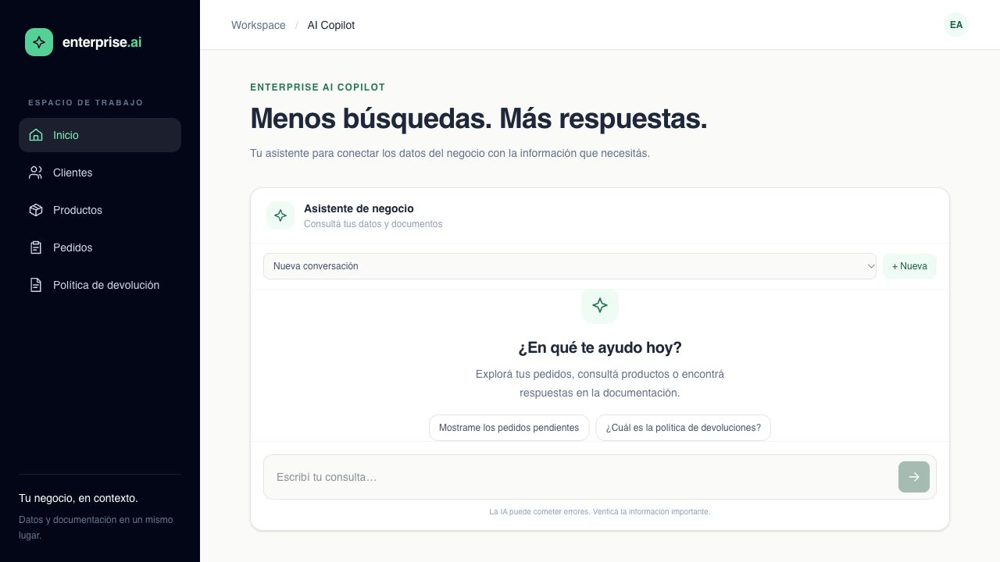
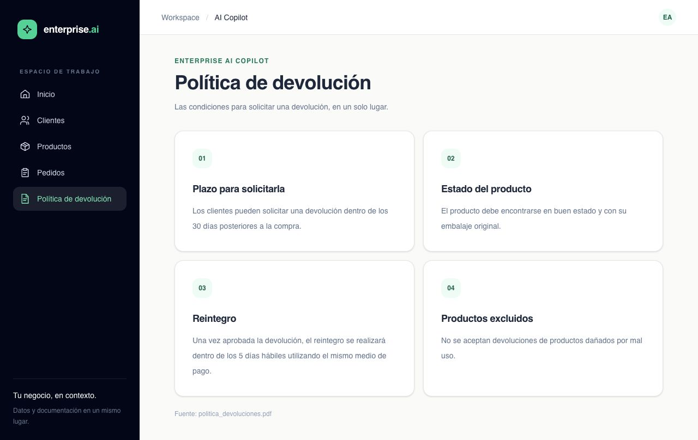
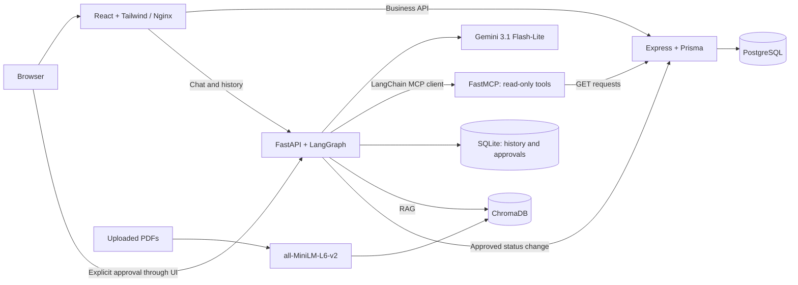

# Enterprise AI Copilot

**Enterprise AI · RAG · MCP · Human-in-the-Loop**


An enterprise AI copilot that connects structured business data and internal knowledge through MCP, Retrieval-Augmented Generation, persistent conversational memory, and human-approved business operations.

Designed to demonstrate end-to-end AI engineering, modular software architecture, reliable tool execution, and controlled integration with enterprise systems.

---

## Key Engineering Features

<table>
    <tr>
        <td width="50%">✅ Model Context Protocol</td>
        <td width="50%">✅ Retrieval-Augmented Generation</td>
    </tr>
    <tr>
        <td width="50%">✅ Human-in-the-Loop</td>
        <td width="50%">✅ Persistent Conversation Memory</td>
    </tr>
    <tr>
        <td width="50%">✅ Incremental Document Indexing</td>
        <td width="50%">✅ Context Window Management</td>
    </tr>
    <tr>
        <td width="50%">✅ Deterministic Business Metrics</td>
        <td width="50%">✅ LLM Tool Calling</td>
    </tr>
    <tr>
        <td width="50%">✅ Controlled State Mutations</td>
        <td width="50%">✅ Modular Service Architecture</td>
    </tr>
    <tr>
        <td width="50%">✅ Document Source Attribution</td>
        <td width="50%">✅ Automated Integration Testing</td>
    </tr>
</table>


## Screenshots





> Local portfolio demo. Authentication and user-level authorization are not implemented. This is not a production deployment.

## Quick start — Docker Compose

Requirements: Docker with Compose and a Google AI Studio API key. No local Node.js or Python installation is needed for this option.

```bash
cp .env.example .env
```

Set `GOOGLE_API_KEY` in the root `.env` file, then start the whole application:

```bash
docker compose up --build -d --wait --wait-timeout 900
```

Open [http://localhost:5173](http://localhost:5173). Compose runs PostgreSQL, Express, the MCP server, the Python agent and the frontend. The first build installs CPU embedding dependencies, and the first startup downloads the embedding model. Both may take several minutes. Startup and health checks do not send prompts to Gemini.

The database is initialized and seeded automatically **only on a new PostgreSQL volume**. The frontend proxies API requests, so only its port is published, bound to localhost. Browser requests and PDF source links use the same origin.

```bash
# Check service health
docker compose ps

# Follow agent and MCP logs
docker compose logs -f agent mcp

# Stop the stack, keeping persistent data
docker compose down
```

If a local Vite server already uses port 5173, stop it or set `WEB_PORT=5174` in the root `.env` and open port 5174 instead. The full-stack Compose creates its own named volumes: it does not reuse or modify data from the older database-only Compose or from your local `agent/data/` directory.

| Root `.env` variable | Default / purpose |
| --- | --- |
| `GOOGLE_API_KEY` | Required at runtime; never included in an image or sent to the browser/MCP server. |
| `WEB_PORT` | `5173`, the only published service port. |
| `POSTGRES_PASSWORD` | Local demo password. Use URL-safe letters, digits and underscores. |
| `CONTEXT_TOKEN_LIMIT` | `6000`, approximate context threshold. |
| `CONTEXT_RECENT_TURNS` | `6`, number of recent complete turns kept verbatim. |

## What the application does

- Queries customers, products, orders and order details through MCP tools.
- Calculates sales metrics in code, with optional date filters.
- Retrieves information from PDFs and links to the consulted document and page.
- Saves conversations and tool results, and summarizes older context when needed.
- Proposes order status changes with explicit confirmation/cancellation controls.
- Records a return as `Devuelto` (returned); it does **not** issue a payment refund.
- Uploads and replaces PDFs without rebuilding the entire vector collection.
- Displays tool execution, sources, pending approvals and conversation summaries in the workspace.

Try asking:

- “Show pending orders for customer 1.”
- “What is the total value of delivered orders between July 1 and July 10, 2026?”
- “What is the returns policy? Include your sources.”
- “Review order 3,” followed by “Who purchased it?” in the same conversation.
- “Change order 2 to Enviado.” The agent prepares a proposal; a write only happens after clicking **Confirmar** (Confirm).

### Language support

This README is in English. The application interface and the agent's configured responses are currently in Spanish. **An EN/ES language selector is not implemented.** English prompts can be submitted, but the current system prompt requests Spanish answers. Tool names and database status values retain their existing Spanish identifiers.

## Architecture



| Directory / file | Responsibility |
| --- | --- |
| `frontend/` | React UI, Vite/Tailwind build and Nginx reverse proxy for Compose. |
| `backend/` | Express API and PostgreSQL access through Prisma. |
| `agent/` | Model orchestration, RAG, history, context summaries and approval flow. |
| `mcp_server/` | Independent FastMCP service reusing the Express API. |
| `database/` | PostgreSQL schema, sample SQL data and the optional database-only Compose. |
| `compose.yaml` | Full-stack orchestration, health-based startup dependencies and persistent volumes. |

### Architecture Decisions

| Choice | Reason | Trade-off |
| --- | --- | --- |
| **MCP** | Separates read-only business integrations from the agent using a discoverable tool protocol. Reuses Express instead of duplicating database access. | Adds a service and connection lifecycle. MCP annotations do not replace application authorization. |
| **PostgreSQL** | Stores related business records and supports transactional order updates with an expected-state check. | Requires database initialization and a running service. |
| **SQLite** | Persists conversations, summaries and approval decisions without another application-level database service. | Fits this single-instance demo; multi-user deployments need an explicit access and concurrency strategy. |
| **ChromaDB** | Stores local vectors and source/page metadata for semantic retrieval and per-document updates. | Local persistence and index synchronization currently assume one agent worker. |

### Agent behavior

- **Model:** Gemini 3.1 Flash-Lite through LangChain.
- **Orchestration:** LangGraph ReAct agent. The integrated `langchain.mcp.MCPAdapter` discovers the MCP catalog on each turn and keeps the session open during execution. Its API is in beta; compatible dependency versions are pinned.
- **RAG:** `all-MiniLM-L6-v2` embeddings, 700-character chunks with 150-character overlap, ChromaDB storage and up to three retrieved fragments per query.
- **Sources:** links are built from retrieved metadata, not model-generated URLs. They identify consulted sources, not an automatic factual verification of every statement.
- **Memory:** full history and tool results remain in SQLite. The model receives a saved summary and recent turns once compaction is needed. This does not train the model.
- **Approval:** the model can propose changes but cannot write directly through MCP. The existing confirmation endpoint applies an approved action, checks the prior order state and prevents repeating the same action.

## MCP tools

| Tool | Inputs / behavior |
| --- | --- |
| `buscar_clientes` | Customer name, country and email filters. |
| `buscar_productos` | Product name, category and minimum stock. |
| `buscar_pedidos` | Optional status and customer filters. |
| `obtener_detalle_pedido` | Order by ID, including customer and product lines. |
| `analizar_pedido` | Reuses the order endpoint to provide order/customer data for the agent's analysis. |
| `metricas_ventas` | Order counts by status, delivered-order total and average ticket; optional inclusive date range. |

Sales metrics recognize **only orders in `Entregado` (delivered) status** and sum each order's recorded `total`, without recalculating its lines. Pending, shipped, cancelled and returned orders do not contribute to that amount. Calculations use `Decimal`, return two decimal places and do not assume a currency. Date filters use the order date; actual delivery dates and payment records are not available.

MCP exposes no generic HTTP proxy, arbitrary SQL or write tools. IDs, statuses, dates and filters are validated. API failures become explicit tool errors rather than empty lists. If discovery or connection fails, the chat returns a clear error and does not silently use duplicate local business tools. Previously saved history and approval decisions remain accessible independently of MCP.

`proponer_cambio_estado` and `proponer_devolucion` remain local agent tools. They read the current state to prepare a proposal; only the confirmation endpoint performs the approved write through Express.

## Documents, context and persistence

Use **Documentos** in the menu to upload text-based PDFs, up to 10 MB. Uploading the same filename replaces that document. Files are synchronized on startup, when listed and before document searches.

SHA-256 hashes in `agent/vectorstore/documents.json` identify changed files. Only new/changed documents generate embeddings. Previous versions and removed files have their old chunks removed, while source/page metadata is retained. An older index is migrated once per document.

When context exceeds the configured threshold, the agent summarizes older messages in bounded batches and keeps the most recent complete turns. The threshold estimates one token per four characters; it is not a strict provider limit. Summarization may add Gemini requests when required, rather than on every message. New tool outputs can exceed the threshold, and summaries may omit details; the full visible history is retained.

| Data | Compose persistence | Manual development location |
| --- | --- | --- |
| Business records | `postgres_data` volume | Volume managed by the database-only Compose. |
| Conversations, summaries and approvals | `conversations` volume | `agent/data/conversations.sqlite3` |
| Vector index and hash manifest | `vectors` volume | `agent/vectorstore/` |
| PDF files | `documents` volume, initialized with the bundled PDFs | `backend/uploads/` |
| Embedding model cache | `embeddings_cache` volume | Hugging Face's local cache. |

Only the two reviewed sample PDFs (`manual_empleados.pdf` and `politica_devoluciones.pdf`) are allowlisted for Git and Docker builds. Other uploaded files are ignored by default. Review the samples again if you replace their contents, and publish only documents you own or have permission to share. The root `.gitignore` and `.dockerignore` also exclude local secrets, dependencies, conversations and generated indexes.

## Manual development setup (optional)

<details>
<summary>Run the services locally without full-stack Compose</summary>

Requirements: Node.js compatible with Vite 8, Python 3.14 (used during development), Docker/Compose for PostgreSQL and a Gemini API key.

From the repository root:

```bash
cp backend/.env.example backend/.env
cp agent/.env.example agent/.env
cp mcp_server/.env.example mcp_server/.env

cd backend
npm ci
npx prisma generate
cd ../frontend
npm ci
cd ..

python3 -m venv agent/venv
source agent/venv/bin/activate
python -m pip install -r agent/requirements.txt -r mcp_server/requirements.txt

docker compose -f database/docker-compose.yml up -d
```

Set `GOOGLE_API_KEY` in `agent/.env`. After PostgreSQL is ready, seed a **new** development database once:

```bash
docker exec -i enterprise-ai-db psql -U postgres -d enterprise_ai -v ON_ERROR_STOP=1 < database/seed.sql
```

This SQL seed is not idempotent. The schema runs automatically only when the database volume is empty.

Run these commands in four terminals, each starting at the repository root:

```bash
# 1. Business API
cd backend && npm run dev
```

```bash
# 2. MCP server
source agent/venv/bin/activate
python -m mcp_server.server
```

```bash
# 3. Agent
cd agent
source venv/bin/activate
python -m uvicorn main:app --reload --port 8000
```

```bash
# 4. Frontend
cd frontend && npm run dev
```

Local endpoints: UI `localhost:5173`, Express `localhost:3001`, agent/OpenAPI `localhost:8000/docs`, and MCP `127.0.0.1:8001/mcp`. MCP is a protocol endpoint, not a web page. Run `npx prisma studio` from `backend/` to inspect PostgreSQL. The chat uses the Python agent.

| Configuration file | Variables / defaults |
| --- | --- |
| `agent/.env` | `GOOGLE_API_KEY`, `MCP_SERVER_URL=http://127.0.0.1:8001/mcp`, `MCP_TIMEOUT_SECONDS=15`, `CONTEXT_TOKEN_LIMIT=6000`, `CONTEXT_RECENT_TURNS=6` |
| `agent/.env`, `mcp_server/.env` | `BUSINESS_API_URL=http://127.0.0.1:3001`, `API_TIMEOUT_SECONDS=10` |
| `agent/.env` | Optional `CORS_ORIGINS` JSON array; default `["http://localhost:5173"]`. |
| `mcp_server/.env` | `MCP_HOST=127.0.0.1`, `MCP_PORT=8001` |
| `frontend/.env` | Optional `VITE_API_URL` and `VITE_AGENT_API_URL`; defaults point to local ports 3001 and 8000. Compose supplies relative proxy paths at build time. |

MCP timeouts cover connection/initialization/tool calls, not model generation. The MCP service can be installed separately with its own requirements; it does not import the agent or need Gemini, ChromaDB or PostgreSQL directly.

</details>

## Tests

These commands use fake models, temporary data and simulated writes. They do not call Gemini or modify real orders:

```bash
cd agent
source venv/bin/activate
python -m unittest test_conversations test_actions test_context_documents -v
cd ..

# Starts and stops temporary MCP/Express servers with simulated Prisma data.
PYTHONPATH=agent:. agent/venv/bin/python -m unittest discover -s mcp_server/tests -v

node --test backend/test/pedidos.test.js

cd frontend
npm run lint
npm run build
```

Coverage includes MCP discovery/HTTP transport, filters, decimal metrics, errors, persistent memory, source metadata, context compaction, incremental indexing, upload validation, approvals, repeated confirmation and stale-state rejection.

## Current limitations

- No authentication, user roles or account-level isolation. History is shared by this local instance.
- No EN/ES selector, OCR for scanned PDFs, payment refunds, multi-agent coordination, RAG quality evaluation suite or cost observability.
- Stored history keeps growing; context compaction reduces model input, not historical storage.
- File synchronization assumes one agent worker. Business list queries and metric aggregation are not paginated.
- MCP is unauthenticated. Compose keeps it on the internal network; manual mode binds it to loopback by default.
- Human approval protects the agent's write path, not every direct business API operation. Public deployment requires a separate authentication/authorization design.
